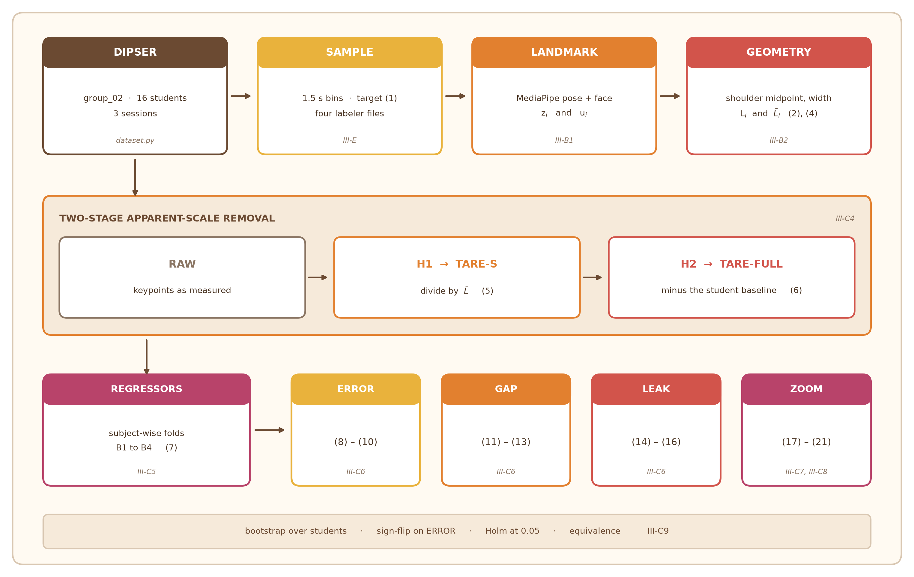
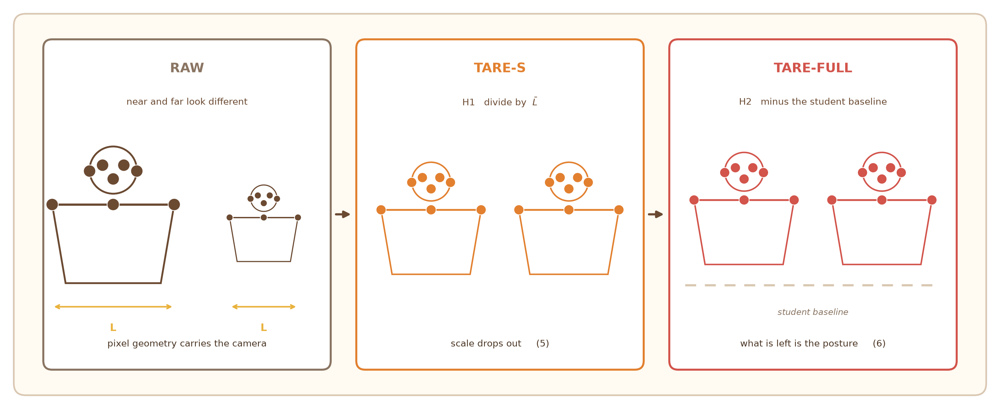
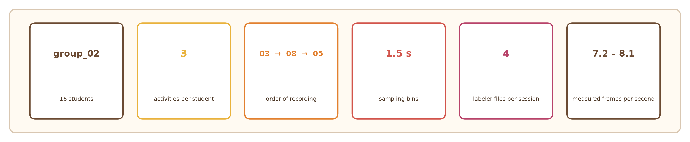
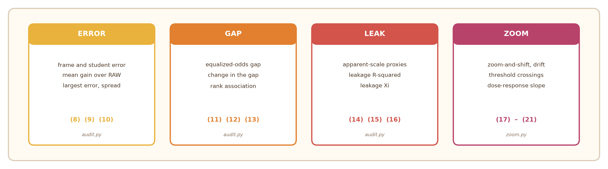

<p align="center">
  
</p>

<h2 align="center"><b>TARE (Two-stage Apparent-scale Removal for Engagement)</b></h2>

<p align="center">
  This repo is the source code of the implementation in the paper "Apparent Scale Bias in Landmark-Based Classroom Student Engagement Estimation: A Controlled, Demographic-Unaware Fairness Audit". The source code and all quantity come from Section III and Table III in the paper.
</p>

<p align="center">
  <a href="https://python.org"></a>
  <a href="requirements.txt"></a>
  <a href="requirements.txt"></a>
  <a href="requirements.txt"></a>
  <a href="tests/"></a>
  <a href="#-what-the-real-files-settled"></a>
  <a href="https://github.com/gmtigrisva123/TEAR"></a>
</p>

<p align="center">
<a href="#-layout" title="Layout"></a>
<a href="#-how-to-run" title="How to run"></a>
<a href="#-traceability" title="Traceability"></a>
</p>

<p align="center">
<a href="#-what-the-real-files-settled" title="What the real files settled"></a>
<a href="#-what-you-still-have-to-supply" title="What you still have to supply"></a>
<a href="#-not-implemented-on-purpose" title="Not implemented, on purpose"></a>
</p>

<p align="center">
<a href="#-what-this-does-and-does-not-contain" title="What this does and does not contain"></a>
<a href="#-things-to-reconcile-in-the-paper" title="Things to reconcile in the paper"></a>
<a href="#-three-readings-worth-knowing-about" title="Three readings worth knowing about"></a>
</p>

<p align="center">
  
</p>

<p align="center">
  
</p>

---

## 🔍 What this does and does not contain

> No frame, landmark, rating or result is generated here. The code reads the
> DIPSER release off disk and stops with an error when something it needs is
> missing, so a missing dataset gives a failed run and never a filled-in one.
> DIPSER frames are not redistributed, per the paper's data disclosure.

The unit tests in `tests/` check Proposition 1, Proposition 2 and Remark 3.
Those are identities that hold for any numbers, and Remark 3 calls the
keypoint-level case a unit test itself, so they are verified on arbitrary
arrays. No test produces a research result.

---

## 🗂️ Layout

<table>
<tr><td width="26%"><code>tare/config.py</code></td><td>Table III, and where the DIPSER files sit</td></tr>
<tr><td><code>tare/dataset.py</code></td><td>III-E: 1.5 s sampling, the rating fill, the target (1)</td></tr>
<tr><td><code>tare/landmarks.py</code></td><td>III-B1, III-C2: MediaPipe, z_i and u_i</td></tr>
<tr><td><code>tare/geometry.py</code></td><td>(2) and the references of III-B2</td></tr>
<tr><td><code>tare/features.py</code></td><td>III-C4: RAW, TARE-S, TARE-FULL, (4) to (6)</td></tr>
<tr><td><code>tare/models.py</code></td><td>III-C5: regressors, subject-wise folds, B1 to B4</td></tr>
<tr><td><code>tare/audit.py</code></td><td>III-C6: ERROR, GAP, LEAK, (8) to (16)</td></tr>
<tr><td><code>tare/zoom.py</code></td><td>III-C7, III-C8: the perturbations, (17) to (21)</td></tr>
<tr><td><code>tare/stats.py</code></td><td>III-C9: bootstrap, sign-flip, Holm, equivalence</td></tr>
<tr><td><code>run_audit.py</code></td><td>Algorithm 1, line by line</td></tr>
</table>

<p align="center">
  
</p>

---

## 🚀 How to run

```bash
python3.11 -m venv .venv && ./.venv/bin/pip install -r requirements.txt
```

Download `pose_landmarker.task` and `face_landmarker.task` from the
MediaPipe model index. Section III-B1 requires a fresh extraction, so the
pose annotations DIPSER ships are never read.

Inspect the labels before the first full run:

```bash
./.venv/bin/python run_audit.py --dipser-root PATH \
    --pose-task pose_landmarker.task --face-task face_landmarker.task \
    --inspect-labels
```

Check the layout before anything else, because the file patterns in
`DipserLayout` are settings rather than facts:

```bash
./.venv/bin/python run_audit.py --dipser-root PATH \
    --pose-task pose_landmarker.task --face-task face_landmarker.task \
    --describe-only
```

Then run the audit:

```bash
./.venv/bin/python run_audit.py --dipser-root PATH \
    --pose-task pose_landmarker.task --face-task face_landmarker.task \
    --session-order sessions.csv --regressor gb
```

`--regressor ridge` runs the other family of III-C5. Both use the Table III
settings for every variant, so a difference between variants comes from the
features. The extraction pass is cached, so a rerun of the audit does not
repeat it; the ZOOM branches re-extract from warped images and are not
cached, which is where the time goes.

---

## 📊 What the real files settled

The release was inspected before any of this was wired up, and four things
Section III leaves open are now decided by the data rather than by a guess.

<p align="center">
  
</p>

**Which group.** Assumption A6 names the 16 students of "group 01". In the
release, group_01 has 19 students with all three activities and group_03 has
15, while **group_02 has exactly 16**, which is also the only group for which
"all of them have a lecture session, so N_lec = 16" holds. `DIPSER_GROUP` is
therefore `02`, and A6 should be corrected in the paper.

**Which evaluator to drop.** Each session has five label files: four named
`labeler_*` and one named `self_labeling`. `rating_glob` matches only the
first kind, so the self-assessment that III-E excludes never reaches (1).
The labeler numbers are not stable across students, one being rated by
labelers 01 to 04 and another by 01, 02, 03 and 05, so the four are taken as
whichever files are present.

**How time is read.** Image names carry a wall-clock timestamp,
`HH_MM_SS_fraction.png`, so t_i and the 1.5 s bins come from the names. The
camera drops frames, which is why a five-minute session holds between 2167
and 2498 images, an effective 7.2 to 8.3 frames per second against a 100 ms
nominal interval. Those dropped stretches are exactly the empty bins III-E
says to flag as missing, and a fixed rate would both hide them and place
frames in the wrong bins.

**Which session is first.** The three activities were filmed as 03 at
12:41, then 08 at 12:46, then 05 at 13:13, so the numeric order is not the
order of recording. Equation (6) wants the earliest session, which is
activity 03, and the order is derived from the timestamps rather than
supplied in a file.

---

## 📥 What I still have to supply

**The data itself.** Unpack each `subject_NN.zip` into a directory named
after it, so the tree reads
`group_02/experiment_03/subject_02/images/...`, and pass the root as
`--dipser-root`. Check with `--describe-only` before a full run.

**Confirmation of the four pending definitions.** Section III-B2 leaves the
face center, shoulder tilt, neck tilt and ear asymmetry as `[PENDING]`.
`tare/geometry.py` implements the anatomical descriptions supplied by the
author, and each function records which description it came from and why it
is written that way. Two constraints from the paper narrowed the choices: an
angle has to survive a scaling and a translation for Proposition 1 to hold,
and the face center has to be a function of the eleven keypoints for
Remark 3 to be the algebraic identity it claims to be. Read those four
docstrings and confirm they say what the authors meant.

---

## 📝 Things to reconcile in the paper

Grouped by whether the paper contradicts the release or only leaves
something open. Line numbers are from the PDF.

### ❌ Contradicts the release, so it has to change

**A6 and III-E name group 01** (lines 1188, 1169). The 16-student cohort
with activities 03, 05 and 08 is group_02: group_01 gives 19 students and
group_03 gives 15. The sentence "all of them have a lecture session, so
N_lec = 16" also holds only for group_02.

**The frame rate is given as about 8.7** (line 1152 and Table III). Sessions
run exactly 300 s and hold 2167 to 2498 images, an effective 7.2 to 8.3
frames per second, varying by session. The nominal interval is 100 ms and
the camera drops frames.

**B4 in (7) assumes a fixed panel of four experts.** It writes y^(r) for
r in 1 to 4 as though expert r were one person across the cohort. The
labeler numbering changes between students: one is rated by labelers 01 to
04 and another by 01, 02, 03 and 05. Position r is the r-th labeler file of
that session. What B4 measures is still well defined per frame, but the
wording implies more than the data holds.

### ⏳ Marked [PENDING] and still open

**Line 721, the four feature definitions.** The anatomical descriptions you
supplied are implemented in `tare/geometry.py` and need writing into the
paper.

**Line 776, the median window and lambda.** Alignment is centered. The share
of frames in which each branch of (4) is active comes out of a run and is
printed by `scripts/report.py`. An anthropometric source for lambda = 4.5 is
still needed and is not something the data can supply.

**Line 615, the r = 0.99 and r = 0.49 comparison** against the DIPSER
metadata: the frame count, the type of correlation, and the manual check of
shoulder width.

**Line 1163, the five-vote majority label.** The paper says no measure in
Section III uses it. Cutting the sentence is simpler than defining the
analysis.

**Line 1200, versions and hardware.** Run on MediaPipe 0.10.14,
scikit-learn 1.9.1, NumPy 2.4.6, OpenCV 5.0.0, on a MacBookPro13,1.

### ➕ Worth adding, from what the data turned out to be

**How t_i is determined.** Image names carry a wall-clock timestamp and the
bins are read from them. This is why dropped frames produce exactly the
empty bins III-E says to flag as missing.

**The empty-bin rate.** 204 of 9597 bins, 2.1%.

**The recording order is 03, then 08, then 05.** Numeric order is not
recording order, and (6) calibrates on the earliest in time, which is 03.
A reader who assumes 05 comes second will misread which session C_s is cut
from.

**How the ratings are filled.** Only attention change points are read, since
a record may carry only an emotion, and the fill runs to the end of the
session rather than to the last change point. One labeler writes a single
entry at second zero for a five-minute session.

**The label distribution.** y runs from 2.00 to 4.75 with nothing below
2.00, and class 3 of Table III holds 12.4% of frames. 80.4% of frames exceed
tau = 2.5. III-C6c cautions about a threshold the predictor seldom crosses;
this is the opposite case, and the rates reported beside the gaps are what
show it.

**N5(i).** Not wrong, but "a window of five frames" reads as five recorded
frames unless the reader carries III-C1's "sampled frame" down to (4).
Saying "five sampled frames, spanning 7.5 s" removes the ambiguity.

---

## 🧠 Three readings worth knowing about

These are places where the paper is silent and the code had to settle on
something. Each is marked in the source.

The median window alignment of (4) is a setting,
`config.MEDIAN_WINDOW_ALIGNMENT`, with centered as the default, which
matches Table II describing the window as sitting around frame i.

Frames with `u_i = 0` are left out of fitting and receive the training mean
as their prediction, per III-C5. Their features are missing throughout, so
there is nothing to fit on. Median imputation still applies to a frame that
is usable but has some component undefined.

Out-of-fold leakage predictions are averaged over the three seeds before
R-squared is computed in (15), following the way (8) averages over seeds
inside each student.

---

## 🧭 Traceability

Every numbered item of Section III and where it lives.

<p align="center">
  
</p>

| Paper | Where |
| --- | --- |
| (1) target, mean of four experts | `dataset._target_at` |
| (2) shoulder midpoint and width | `geometry.shoulder_midpoint`, `geometry.shoulder_width` |
| (3) weak-perspective pixel length | not implemented, see below |
| (4) in-frame scale L and its windowed median | `geometry.in_frame_scale`, `features.in_frame_scales` |
| (5) keypoints relative to m in units of L-bar | `features.tare_s_vector` |
| (6) stage H2 baseline and calibrated features | `features.student_baselines`, `features.tare_full_matrix` |
| (7) B1 to B4 | `models.reference_predictors`, `models.human_reference` |
| (8) frame and student error | `audit.frame_errors`, `audit.student_errors` |
| (9) ERROR and the gains over RAW | `audit.error_summary` |
| (10) largest student error and spread | `audit.error_summary` |
| (11) equalized-odds gap | `audit.equalized_odds` and the two forms around it |
| (12) change in the gap | `audit.gap_change` |
| (13) rank association and its change | `audit.rank_association`, `audit.association_change` |
| (14) the two apparent-scale proxies | `audit.apparent_scale_proxies` |
| (15) leakage R-squared | `audit.leakage` |
| (16) leakage Xi | `audit.leakage` |
| (17) zoom-and-shift map | `zoom.apply_keypoint_map`, `zoom.affine_matrix` |
| (18) drift | `zoom.drift` |
| (19) threshold-crossing rate | `zoom.flip_rate` |
| (20) dose-response curve and its slope | `zoom.dose_response`, `zoom.log_linear_fit` |
| (21) perturbed-cohort disparity | `zoom.perturbed_cohort` |
| Proposition 1, exact invariance | `tests/test_propositions.py` |
| Proposition 2, centering | `tests/test_propositions.py` |
| Remark 3, keypoint drift is a unit test | `tests/test_propositions.py` |
| Algorithm 1, lines 1 to 20 | `run_audit.py` |
| A1 to A7 | A1 and A2 in `geometry`/`features`, A3 in `landmarks` and `dataset`, A4 in `dataset`, A5 in `audit.apparent_scale_proxies`, A6 in `dataset.load_cohort`, A7 in `features.student_baselines` |

Intervals follow III-C9. The mean gain, the quantities of (10), the gaps of
(11), the association of (13), the leakage of (15) and (16), the drift of
(18), the slope of (20) and the spreads of (21) each come with a bootstrap
over students, with a student's group carried along. The primary family of
ten comparisons gets the sign-flip test on ERROR, the bootstrap share for
the gap changes, and Holm at 0.05.

---

## 🚫 Not implemented, on purpose

Equation (3), the weak-perspective decomposition of a pixel length into
scale, true length and foreshortening, has no code. III-C3 says the model
"serves only to interpret the origin of scale" and that the invariance in
Proposition 1 does not rely on it, so implementing it would mean choosing a
focal length and a camera distance the paper never gives. Remark 1 reads the
five residual mechanisms off it, and those are read from the measurements
rather than computed.

III-E keeps the five-vote majority label as a secondary target and then
marks the secondary analysis as `[PENDING]`, noting that no measure in
Section III uses it. It is therefore not read. Once you define that
analysis, the label has to be loaded in `dataset.py`.

III-B1 reports a correlation of r = 0.99 on interocular distance and
r = 0.49 on shoulder width between a fresh MediaPipe run and the DIPSER
metadata, with the frame count, correlation type and the manual check of
shoulder width all marked `[PENDING]`. The code never mixes the two sources,
which is the conclusion the paper draws, so reproducing that comparison is a
separate script and not part of the pipeline.

III-G marks the MediaPipe and scikit-learn versions, the hardware and the
code availability statement as `[PENDING]`. `requirements.txt` has what this
was tested against.
