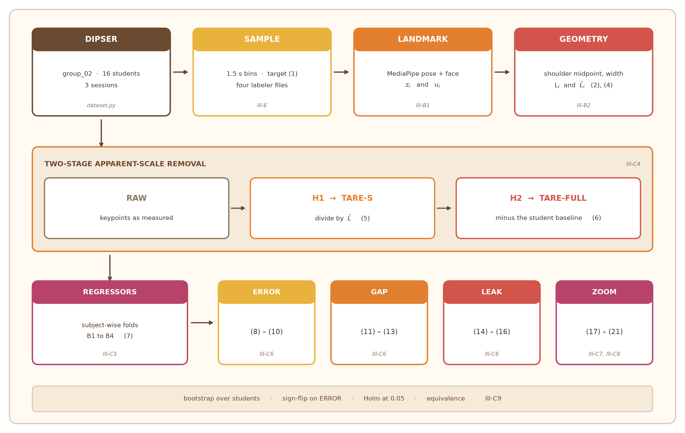
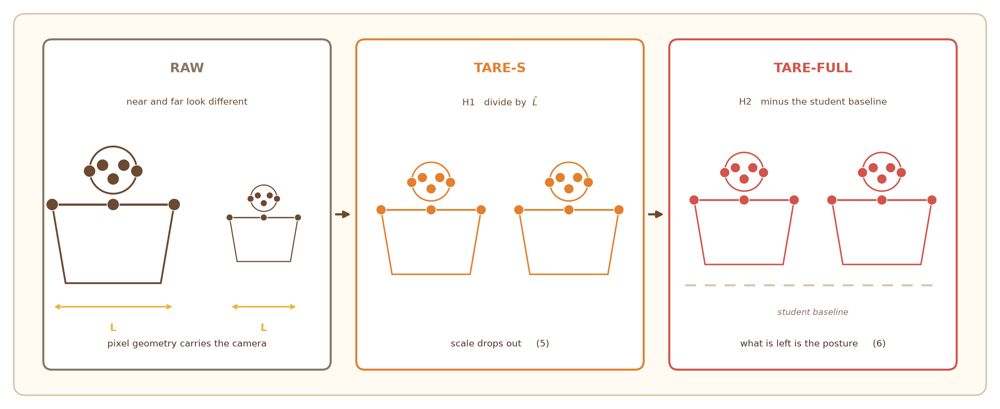
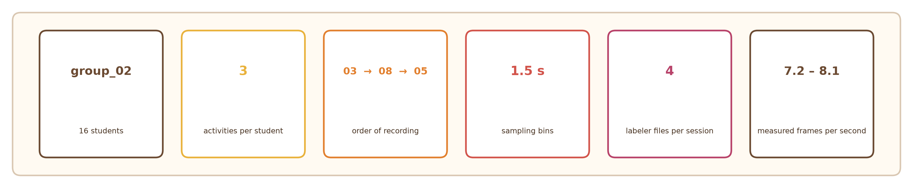
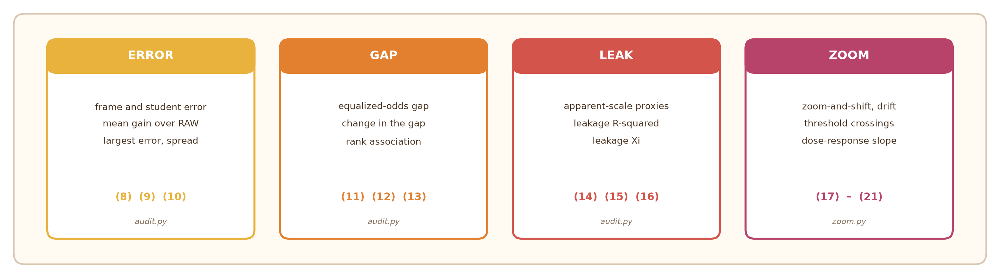

<p align="center">
  
</p>

<p align="center">
  This repository contains the code behind the paper “Apparent Scale Bias in Landmark-Based Classroom Student Engagement Estimation: A Controlled, Demographic-Unaware Fairness Audit”. It follows Section III and Table III.
</p>

<p align="center">
  <a href="https://python.org"></a>
  <a href="requirements.txt"></a>
  <a href="requirements.txt"></a>
  <a href="requirements.txt"></a>
  <a href="tests/"></a>
  <a href="#what-the-data-tells-us"></a>
  <a href="https://github.com/gmtigrisva123/TARE"></a>
</p>

<p align="center">
<a href="#project-map" title="Project map"></a>
<a href="#run-it" title="Run it"></a>
<a href="#paper-to-code" title="Paper to code"></a>
</p>

<p align="center">
<a href="#what-the-data-tells-us" title="What the data tells us"></a>
<a href="#what-you-need-to-provide" title="What you need to provide"></a>
<a href="#not-implemented-on-purpose" title="Not implemented on purpose"></a>
</p>

<p align="center">
<a href="#scope" title="Scope"></a>
<a href="#paper-notes" title="Notes for the paper"></a>
<a href="#implementation-choices" title="Implementation choices"></a>
</p>

<p align="center">
  
</p>

<p align="center">
  
</p>

---

## Scope

This code reads a DIPSER release from disk, extracts landmarks, builds the features, fits the models, and reports the audit measures.

It does not include DIPSER frames, labels, or precomputed research results. If a required input is missing, the run stops with an error; it never fills in missing data. DIPSER frames are not redistributed, in keeping with the paper's data disclosure.

The tests in `tests/` check Proposition 1, Proposition 2, and Remark 3 on arbitrary arrays. These are mathematical identities, not tests of the research findings, so the test suite does not produce a research result.

---

## Project map

| File | What it does |
| --- | --- |
| `tare/config.py` | Table III settings and the expected DIPSER layout |
| `tare/dataset.py` | III-E: 1.5-second sampling, rating fill, and target (1) |
| `tare/landmarks.py` | III-B1 and III-C2: MediaPipe, $z_i$, and $u_i$ |
| `tare/geometry.py` | Equation (2) and the geometry from III-B2 |
| `tare/features.py` | III-C4: RAW, TARE-S, TARE-FULL, and equations (4)-(6) |
| `tare/models.py` | III-C5: regressors, subject-wise folds, and B1-B4 |
| `tare/audit.py` | III-C6: ERROR, GAP, LEAK, and equations (8)-(16) |
| `tare/zoom.py` | III-C7 and III-C8: perturbations and equations (17)-(21) |
| `tare/stats.py` | III-C9: bootstrap, sign-flip, Holm, and equivalence tests |
| `run_audit.py` | The end-to-end pipeline from Algorithm 1 |

The three feature variants differ in what information they keep. Model settings stay the same across variants, so their comparison is about the features, not a separately tuned model.

<p align="center">
  
</p>

---

## Run it

Create an environment and install the pinned dependencies:

```bash
python3.11 -m venv .venv
./.venv/bin/pip install -r requirements.txt
```

Download `pose_landmarker.task` and `face_landmarker.task` from the
MediaPipe model index. Section III-B1 requires a fresh extraction, so the
pose annotations DIPSER ships are never read.

Before a full run, inspect the labels:

```bash
./.venv/bin/python run_audit.py --dipser-root PATH \
    --pose-task pose_landmarker.task --face-task face_landmarker.task \
    --inspect-labels
```

Next, check that the files on disk match the configured layout:

```bash
./.venv/bin/python run_audit.py --dipser-root PATH \
    --pose-task pose_landmarker.task --face-task face_landmarker.task \
    --describe-only
```

If the layout looks right, run the audit:

```bash
./.venv/bin/python run_audit.py --dipser-root PATH \
    --pose-task pose_landmarker.task --face-task face_landmarker.task \
    --session-order sessions.csv --regressor gb
```

Use `--regressor ridge` for the other model family in III-C5. Landmark extraction is cached between runs. ZOOM applies transformations to images and re-extracts landmarks, so that part is not cached and takes the extra time.

---

## What the data tells us

Inspecting the actual release settled four details that Section III leaves open. These decisions come from the files, not from guesswork.

<p align="center">
  
</p>

**The cohort is group 03.** A6 names 16 students from “group 03”. In the release, group 01 has 20 students with all three activities, group 02 has 21, and group 03 has exactly 16. It is also the only group where all 16 students have a lecture session. The code therefore uses `DIPSER_GROUP = "03"`; A6 should be corrected in the paper.

**Self-ratings are excluded.** Each session has four `labeler_*.json` files and one `self_labeling.json`. The configured pattern reads only the labeler files, as III-E requires. Labeler IDs vary by student, so the four available files are used rather than expecting the same four IDs for everyone.

**Time comes from image names.** Filenames contain wall-clock timestamps in the form `HH_MM_SS_fraction.png`, so the pipeline uses those timestamps for $t_i$ and the 1.5-second bins. Each five-minute session has 2167 to 2498 images, or 7.2 to 8.3 frames per second. The camera's nominal interval is 100 ms, but it drops frames. Using timestamps preserves the empty bins that III-E says to mark as missing; assuming a fixed rate would hide them and misplace frames.

**The recording order is 03, 08, 05.** Activities were recorded at 12:41, 12:46, and 13:13, respectively. Equation (6) uses the earliest session for calibration, so activity 03 comes first. The code derives this order from timestamps rather than numeric activity IDs.

---

## What you need to provide

The DIPSER data and the two MediaPipe model files are external inputs. Unpack each `subject_NN.zip` into a directory with the same name. The expected layout looks like this:

```text
group_03/experiment_03/subject_02/images/...
```

Pass the directory containing `group_03` as `--dipser-root`, then use `--describe-only` to check the layout before a full run.

You also need to confirm four feature definitions that Section III-B2 marks `[PENDING]`: face center, shoulder tilt, neck tilt, and ear asymmetry. The proposed anatomical definitions are implemented in `tare/geometry.py`; each function's docstring records its source and reasoning. Two constraints narrow the choices: angles must be invariant to scaling and translation for Proposition 1, and the face center must use the eleven keypoints for Remark 3 to hold as stated. Please check that the definitions match the authors' intent before treating them as final.

---

## Notes for the paper

Here are the places where the paper should be updated or completed. PDF line numbers are included to make them easier to find.

### The release disagrees with the paper

**A6 and III-E name group 03** (lines 1188 and 1169). The 16-student cohort with activities 03, 05, and 08 is group 03. Group 01 has 20 students and group 02 has 21. The statement that all students have a lecture session, so $N_{lec}=16$, also holds only for group 03.

**B4 in (7) reads like a fixed panel of four experts.** Labeler IDs change between students. One student has labelers 01-04; another has 01, 02, 03, and 05. Here, $r$ means the position of a labeler file within a session, not a person who rated every student. B4 is still defined per frame, but the paper should make that distinction clear.

### Still marked `[PENDING]`

**Median window and $\lambda$ (line 776):** alignment is centered. `scripts/report.py` prints the share of frames using each branch of (4). The paper still needs an anthropometric source for $\lambda=4.5$; the data cannot provide one.

**Landmark comparison (line 615):** the reported $r=0.99$ for interocular distance and $r=0.49$ for shoulder width need a frame count, correlation type, and manual shoulder-width check against DIPSER metadata.

**Versions and hardware (line 1200):** the recorded environment is MediaPipe 0.10.14, scikit-learn 1.9.1, NumPy 2.4.6, OpenCV 5.0.0, on a MacBookPro13,1.

### Useful details to add

**How $t_i$ is determined:** timestamps come from image names. Dropped frames therefore create the empty bins that III-E says to flag.

**Empty bins:** 204 of 9597 bins, or 2.1%.

**Recording order:** 03, then 08, then 05. Equation (6) calibrates on activity 03, the earliest session; numeric order would give the wrong impression about which session supplies $C_s$.

**Rating fill:** only attention change points are read because a record can contain an emotion without an attention rating. Each rating fills through the end of the session, not just to the last change point. One labeler has a single entry at second zero for a five-minute session.

**Label distribution:** $y$ ranges from 2.00 to 4.75, with no values below 2.00. Class 3 in Table III contains 12.4% of frames, and 80.4% of frames exceed $\tau=2.5$. This is the opposite of the seldom-crossed threshold case discussed in III-C6c; report the rates alongside the gaps.

**Window wording:** “five sampled frames, spanning 7.5 s” is clearer than “a window of five frames”, which could sound like five consecutive recorded frames rather than five sampled frames.

---

## Implementation choices

The paper does not settle every implementation detail. These choices are explicit in the code:

- The median window in (4) is centered by default. `config.MEDIAN_WINDOW_ALIGNMENT` makes the alignment configurable; centered matches Table II's description of a window around frame $i$.

- Frames with $u_i=0$ are excluded from fitting and get the training mean as their prediction, as described in III-C5. Their features are all missing, so they cannot train a model. Median imputation still handles an otherwise usable frame with an undefined component.

- For leakage R-squared in (15), out-of-fold predictions are averaged across the three seeds before computing $R^2$. This follows the seed-averaging convention in (8).

---

## Paper to code

The table below maps the equations and propositions in Section III to their implementation.

<p align="center">
  
</p>

| Paper | Implementation |
| --- | --- |
| (1) Target, mean of four experts | `dataset._target_at` |
| (2) Shoulder midpoint and width | `geometry.shoulder_midpoint`, `geometry.shoulder_width` |
| (3) Weak-perspective pixel length | Not implemented; see below |
| (4) In-frame scale $L$ and windowed median | `geometry.in_frame_scale`, `features.in_frame_scales` |
| (5) Keypoints relative to $m$, in units of $\bar{L}$ | `features.tare_s_vector` |
| (6) Stage H2 baseline and calibrated features | `features.student_baselines`, `features.tare_full_matrix` |
| (7) B1-B4 | `models.reference_predictors`, `models.human_reference` |
| (8) Frame and student error | `audit.frame_errors`, `audit.student_errors` |
| (9) ERROR and gains over RAW | `audit.error_summary` |
| (10) Largest student error and spread | `audit.error_summary` |
| (11) Equalized-odds gap | `audit.equalized_odds` and the two forms around it |
| (12) Change in the gap | `audit.gap_change` |
| (13) Rank association and its change | `audit.rank_association`, `audit.association_change` |
| (14) Apparent-scale proxies | `audit.apparent_scale_proxies` |
| (15) Leakage $R^2$ | `audit.leakage` |
| (16) Leakage $\Xi$ | `audit.leakage` |
| (17) Zoom-and-shift map | `zoom.apply_keypoint_map`, `zoom.affine_matrix` |
| (18) Drift | `zoom.drift` |
| (19) Threshold-crossing rate | `zoom.flip_rate` |
| (20) Dose-response curve and slope | `zoom.dose_response`, `zoom.log_linear_fit` |
| (21) Perturbed-cohort disparity | `zoom.perturbed_cohort` |
| Proposition 1, exact invariance | `tests/test_propositions.py` |
| Proposition 2, centering | `tests/test_propositions.py` |
| Remark 3, keypoint drift is a unit test | `tests/test_propositions.py` |
| Algorithm 1, lines 1-20 | `run_audit.py` |
| A1-A7 | A1-A2: `geometry`/`features`; A3: `landmarks`/`dataset`; A4: `dataset`; A5: `audit.apparent_scale_proxies`; A6: `dataset.load_cohort`; A7: `features.student_baselines` |

Intervals follow III-C9. The mean gain, quantities in (10), gaps in (11), association in (13), leakage in (15)-(16), drift in (18), slope in (20), and spreads in (21) use a bootstrap over students, preserving each student's group. The primary family of ten comparisons uses a sign-flip test on ERROR, the bootstrap share for gap changes, and Holm correction at 0.05.

---

## Not implemented on purpose

Equation (3), the weak-perspective decomposition of a pixel length into scale, true length, and foreshortening, is not implemented. III-C3 says the model “serves only to interpret the origin of scale”, and Proposition 1 does not rely on it. Implementing it would mean choosing a focal length and camera distance that the paper never gives. Remark 1's five residual mechanisms are read from measurements, not computed from this equation.

III-B1 reports $r=0.99$ for interocular distance and $r=0.49$ for shoulder width between a fresh MediaPipe run and DIPSER metadata. The frame count, correlation type, and manual shoulder-width check remain `[PENDING]`. The code keeps the two sources separate; reproducing the comparison belongs in a separate script.

III-G leaves versions, hardware, and code availability `[PENDING]`. `requirements.txt` lists the versions tested for this implementation.
